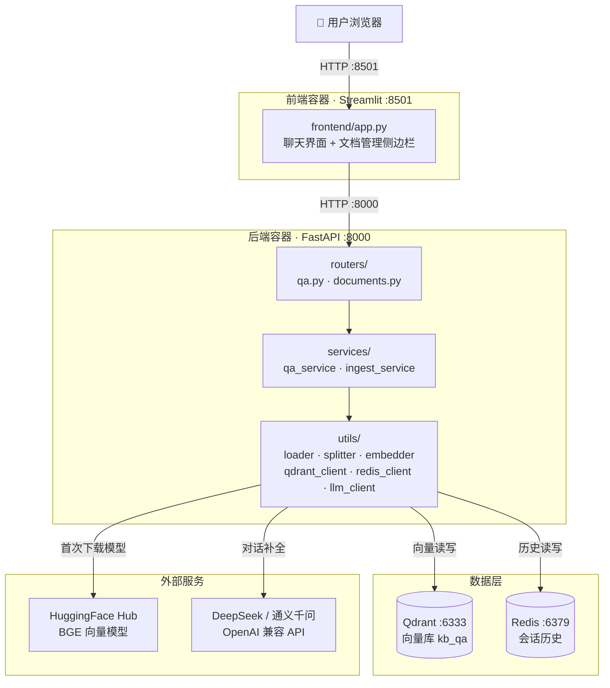

# 知识库问答系统（RAG Knowledge Base QA）

基于 RAG（检索增强生成）的中文知识库问答系统。上传 PDF / Markdown / TXT 文档，用自然语言提问，
系统会检索相关内容并**给出带引用来源的回答**，支持多轮对话。

> 一句话理解：文档 → 切分 → 向量化 → 存进 Qdrant；提问 → 向量检索 → 把命中的片段喂给大模型 → 带引用作答。

---

## 目录

- [功能列表](#功能列表)
- [系统架构](#系统架构)
- [技术栈](#技术栈)
- [目录结构](#目录结构)
- [快速开始](#快速开始)
- [API 文档](#api-文档)
- [已知限制](#已知限制)
- [后续计划](#后续计划)
- [常见问题](#常见问题)

---

## 功能列表

| 功能 | 说明 |
|---|---|
| 📄 文档上传 | 支持 PDF / Markdown / TXT，按内容哈希去重命名，自动解析与入库 |
| 🔍 向量检索 | BGE 中文向量模型 + Qdrant 余弦相似度检索 Top-K 片段 |
| 📖 引用来源 | 回答中的 `[1]` `[2]` 可展开为原文片段，附文件名、页码、相似度分数 |
| 💬 多轮对话 | 会话历史存 Redis，追问会自动改写成独立问题后再检索 |
| 🗂️ 文档管理 | 列出已入库文档及 chunk 数，支持按来源删除（向量 + 本地文件一起删） |
| 🔄 重建索引 | 一键把 `documents/` 目录下的全部文档重新入库，用于向量库被清空后恢复 |
| 🩺 健康检查 | `/health` 返回 Qdrant 连接状态与向量维度，便于排障 |

---

## 系统架构



**两条核心链路：**

- **入库**：上传 → 按扩展名解析（PDF 逐页 / MD 按标题）→ 切分成 400 字左右的 chunk → BGE 转向量 → 写入 Qdrant
- **问答**：提问 → 读 Redis 历史 → （有历史时）LLM 改写追问 → 向量检索 Top-K → 拼成 `【资料N】` 上下文 → LLM 作答 → 回写历史

> 组件职责、时序图、数据模型与关键设计取舍见 [`docs/ARCHITECTURE.md`](docs/ARCHITECTURE.md)。

---

## 技术栈

| 层次 | 选型 | 说明 |
|---|---|---|
| 后端框架 | FastAPI 0.141 | 自带 OpenAPI / Swagger UI，接口用 Pydantic 校验 |
| 前端 | Streamlit 1.64 | 纯 Python 写聊天式 UI，无需前端工程化 |
| 向量数据库 | Qdrant 1.19 | 存 chunk 向量 + payload，COSINE 距离 |
| 向量模型 | BAAI/bge-small-zh-v1.5 | 中文小模型，512 维，CPU 可跑 |
| 推理框架 | sentence-transformers 3.2 + PyTorch 2.14 | 加载并运行 BGE |
| 大模型 | DeepSeek / 通义千问 | 通过 `openai` SDK 走 OpenAI 兼容协议，换模型只改 `.env` |
| 会话存储 | Redis 7 | List 结构存多轮历史，带 TTL 自动过期 |
| 文档解析 | pdfplumber / pdfminer.six | PDF 按页提取文本，保留页码 |
| 文本切分 | langchain-text-splitters | Markdown 标题切分 + 递归字符切分 |
| 部署 | Docker Compose | 四个服务一条命令拉起 |

---

## 目录结构

```
project-zhishiku/
├── app/                        # 后端（FastAPI）
│   ├── main.py                 # 应用入口：注册路由、启动时确保集合存在、/health
│   ├── config.py               # Settings 类，集中读取 .env
│   ├── routers/
│   │   ├── qa.py               # /qa/ask、/qa/clear
│   │   └── documents.py        # /documents/upload|reindex|list|delete
│   ├── services/               # 业务编排层
│   │   ├── qa_service.py       # 问答编排：历史 → 改写 → 检索 → 拼上下文 → LLM → 存历史
│   │   └── ingest_service.py   # 入库编排：加载 → 切分 → 向量化 → 写入
│   └── utils/                  # 单一职责的工具层
│       ├── loader.py           # 文件解析：PDF 逐页提取，MD/TXT 整体读取
│       ├── splitter.py         # 文本切分：MD 先按标题再按长度，其余递归切分
│       ├── embedder.py         # BGE 模型单例（懒加载，进程内只加载一次）
│       ├── qdrant_client.py    # Qdrant 封装：建集合 / upsert / 检索 / 列举 / 删除
│       ├── redis_client.py     # 会话历史读写
│       └── llm_client.py       # OpenAI 兼容客户端（DeepSeek / 通义千问切换）
├── frontend/
│   ├── app.py                  # Streamlit 界面：聊天区 + 侧边栏文档管理
│   └── requirements.txt        # 前端独立依赖（只有 streamlit/requests/dotenv）
├── documents/                  # 文档存储目录（哈希命名），由 compose 挂载进容器
├── test_docs/                  # 示例文档
├── tests.py                    # ⚠️ 不是单元测试，是批量入库脚本
├── docker-compose.yml          # 四服务编排：qdrant / redis / backend / frontend
├── backend.Dockerfile
├── frontend.Dockerfile
├── requirements.txt            # 后端依赖（pip freeze 锁定版本）
└── .env.example                # 配置模板，复制为 .env 后使用
```

---

## 快速开始

### 前置要求

- Docker Desktop（自带 Compose v2）
- 一个可用的 LLM API Key（[DeepSeek](https://platform.deepseek.com) 或[通义千问](https://bailian.console.aliyun.com)）
- 磁盘空间 ≥ 15 GB（后端镜像约 10.7 GB —— 主要是 PyTorch 及其 CUDA 依赖）

### 启动

```bash
# 1. 克隆
git clone https://github.com/<your-name>/project-zhishiku.git
cd project-zhishiku

# 2. 准备配置
cp .env.example .env
#    编辑 .env，把 LLM_API_KEY 换成你自己的 Key

# 3. 一键启动（首次构建要下载依赖，约 5~15 分钟）
docker compose up --build
```

启动后访问：

| 地址 | 说明 |
|---|---|
| http://localhost:8501 | 前端界面（从这里开始用） |
| http://localhost:8000/docs | 后端 Swagger API 文档 |
| http://localhost:6333/dashboard | Qdrant 控制台 |

### 第一次使用

1. 打开 http://localhost:8501，在左侧「📁 文档管理」里**上传一个 PDF / MD / TXT**，点「确认上传」
2. 上传成功后，「已入库文档」会列出该文档及 chunk 数
3. 在下方输入框提问，回答里会带 `[1]` `[2]` 引用标记，点开「📖 查看引用来源」看原文

> ⏱️ **首次提问会慢一些**：后端需要下载 BGE 向量模型（约 95 MB），之后缓存在 `hf_cache` 卷里，重启不重复下载。

### 常用命令

```bash
docker compose up -d           # 后台启动
docker compose logs -f backend # 看后端日志
docker compose down            # 停止（保留数据）
docker compose down -v         # 停止并清空 Qdrant/Redis 数据
```

> 重启 Docker Desktop 之后容器不会自动拉起（优雅停止会被视为"手动停止"，`restart: unless-stopped` 不再生效），
> 重新执行一次 `docker compose up -d` 即可，数据都还在卷里。

### 本地开发（不用 Docker 跑后端）

`.env` 里 `QDRANT_HOST` / `REDIS_HOST` 默认就是 `localhost`，正是为本地开发准备的
（容器里会被 compose 的 `environment` 覆盖成 `qdrant` / `redis`）。

```bash
# 只起依赖服务
docker compose up -d qdrant redis

# 后端
python -m venv .venv
.venv\Scripts\activate            # Windows；macOS/Linux 用 source .venv/bin/activate
pip install -r requirements.txt
uvicorn app.main:app --reload --port 8000

# 前端
pip install -r frontend/requirements.txt
streamlit run frontend/app.py
```

---

## API 文档

Base URL：`http://localhost:8000`　交互式文档：`/docs`（Swagger）/ `/redoc` / `/openapi.json`

| 方法 | 路径 | 说明 |
|---|---|---|
| `GET` | `/health` | 健康检查：Qdrant 状态、集合信息、向量维度 |
| `POST` | `/qa/ask` | 提问，返回回答与引用 |
| `POST` | `/qa/clear` | 清空指定会话的历史 |
| `POST` | `/documents/upload` | 上传文档并入库（multipart） |
| `POST` | `/documents/reindex` | 把 `documents/` 目录下所有文档重新入库 |
| `GET` | `/documents/list` | 列出已入库文档及 chunk 数 |
| `POST` | `/documents/delete` | 按来源删除文档（向量 + 本地文件） |

### `GET /health`

```bash
curl http://localhost:8000/health
```

```json
{
  "status": "ok",
  "qdrant": { "exists": true, "indexed_vectors_count": 0, "points_count": 15, "status": "green" },
  "embedding": { "model": "BAAI/bge-small-zh-v1.5", "dim": 512 }
}
```

### `POST /qa/ask`

提问。`session_id` 为空则本次不读写历史（单轮模式）。

```bash
curl -X POST http://localhost:8000/qa/ask \
  -H "Content-Type: application/json" \
  -d '{"question": "这篇文档讲了什么？", "top_k": 3, "session_id": "demo-001"}'
```

```json
{
  "answer": "文档主要介绍了…… [1]",
  "citations": {
    "1": {
      "text": "命中的原文片段……",
      "source": "documents/f0ed6380caff6f7d.md",
      "original_name": "sample.md",
      "page": null,
      "score": 0.7351
    }
  }
}
```

### `POST /qa/clear`

```bash
curl -X POST http://localhost:8000/qa/clear \
  -H "Content-Type: application/json" -d '{"session_id": "demo-001"}'
```

### `POST /documents/upload`

```bash
curl -X POST http://localhost:8000/documents/upload -F "file=@./你的文档.pdf"
```

```json
{ "message": "上传并入库成功", "filename": "9b3a816e795037b1.pdf", "original_name": "你的文档.pdf", "chunks": 6 }
```

> 重复上传同一份文件不会产生重复数据，返回 `文件已存在，已重新入库`。
> 落盘文件按 `sha256(内容)[:16] + 扩展名` 命名，因此内容相同即同一个文件。

### `POST /documents/reindex`

```bash
curl -X POST http://localhost:8000/documents/reindex
```

```json
{ "message": "已重新入库 3 个文件", "files": 3, "chunks": 15 }
```

### `GET /documents/list`

```bash
curl http://localhost:8000/documents/list
```

```json
{ "documents": [ { "source": "documents/f0ed6380caff6f7d.md", "chunks": 8, "original_name": "sample.md" } ] }
```

### `POST /documents/delete`

删除 Qdrant 中该来源的全部向量，并删除位于上传目录内的本地文件。

```bash
curl -X POST http://localhost:8000/documents/delete \
  -H "Content-Type: application/json" -d '{"source": "documents/f0ed6380caff6f7d.md"}'
```

```json
{ "message": "删除成功", "source": "documents/f0ed6380caff6f7d.md", "deleted_chunks": 8 }
```

---

## 已知限制

诚实地记录当前没做好的地方：

1. **配置项与实现不符**：`RETRIEVAL_CANDIDATES`、`RERANK_CANDIDATES` 在 `config.py` / `.env` 里存在，但代码从未使用。
   实际情况是**单路向量检索直接取 Top-K**，没有"召回 + 重排"两阶段，也没有 CrossEncoder 重排模型。
2. **检索没有过滤和阈值**：不能限定"只在某个文档里提问"，也没有相似度阈值，
   即使命中的片段完全不相关，也照样塞进上下文（只能靠提示词让模型回答"无法回答"）。
3. **`original_name` 会丢**：原始文件名只在上传时记录。通过「重建索引」或 `tests.py` 入库的文档没有这个名字，
   前端会退化成显示哈希文件名。
4. **切分策略较粗**：固定 400 字 / 50 字重叠。PDF 按页切分，跨页的表格和段落会被切断；
   扫描件（图片型 PDF）无法提取文本。
5. **上传是同步阻塞的，且没有大小限制**：解析 + 向量化 + 写库全在一个 HTTP 请求里完成，
   而且 `await file.read()` 会把整个文件读进内存 —— 一个大文件就能打满后端内存。
   没有任务队列、没有进度反馈，前端超时时间设成了 600 秒来兜底。
6. **无鉴权、无多租户**：任何能访问 8000 端口的人都能上传和删除文档；所有用户共享同一个知识库。
7. **单进程串行推理**：uvicorn 单 worker，BGE 模型常驻内存；向量化在 FastAPI 的线程池里执行，并发高时会排队。
8. **没有单元测试**：仓库里的 `tests.py` 名字有误导性，它其实是批量入库脚本，不是测试用例。
9. **会话上下文会截断**：只取最近 6 轮历史，没有摘要压缩，长对话早期信息会丢失。

---

## 后续计划

- [ ] **两阶段检索**：向量召回 Top-N → CrossEncoder 重排 → Top-K（把现有那两个配置项真正用起来）
- [ ] **检索质量**：加相似度阈值、元数据过滤（按文档/时间范围提问）、"无相关内容"短路
- [ ] **异步入库**：引入任务队列（arq / RQ）+ 入库进度推送，上传接口立刻返回
- [ ] **流式输出**：回答改用 SSE 边生成边显示，并支持会话摘要压缩
- [ ] **元数据完善**：文档标题、上传时间、来源类型独立存储，不再依赖 payload 里的 `original_name`
- [ ] **格式扩展**：DOCX / HTML，以及扫描件 OCR
- [ ] **工程质量**：pytest 单元测试 + GitHub Actions CI，把 `tests.py` 改名为 `batch_ingest.py`
- [ ] **安全**：API Key 鉴权、上传大小限制、多租户隔离

---

## 常见问题

**Q：`docker: unknown command: docker compose`**

Docker CLI 找不到 Compose 插件。先确认用户级插件目录里有没有它：

```powershell
Get-ChildItem "$env:USERPROFILE\.docker\cli-plugins"
```

**注意：把 `.exe` 复制进这个目录是无效的** —— Docker Desktop 启动时会清理它（实测重启后
`docker-compose.exe` 被删掉，只剩 `docker-buildx.exe`）。

正确做法是在 `~/.docker/config.json` 里加 `cliPluginsExtraDirs`，直接指向 Docker Desktop 自带的插件目录
（这样也能跟着 Docker Desktop 升级自动更新，不会留下过期副本）：

```jsonc
{
  "cliPluginsExtraDirs": ["C:\\Users\\<你>\\AppData\\Local\\Programs\\DockerDesktop\\resources\\cli-plugins"],
  "auths": {},
  // ...其余配置保持不变
}
```

> 环境变量 `DOCKER_CLI_PLUGIN_EXTRA_DIRS` **不是** Docker CLI 支持的选项，设了没用，别绕这个弯路。

**Q：构建时报 `Could not find a version that satisfies the requirement pywin32==312`**

`requirements.txt` 是从 Windows 环境 `pip freeze` 出来的，`pywin32` 没有 Linux 版本。
本仓库已用环境标记处理（`pywin32==312; sys_platform == "win32"`），Linux 下会自动跳过。
如果你重新 freeze 过依赖，注意保留这个标记。

**Q：服务起来后第一次提问卡好几分钟，像卡死了**

模型加载时默认会去 HuggingFace 检查有没有更新，网络不通时 `huggingface_hub` 会重试 5 次
（每次连接超时 10s + 退避），表现成"卡死"。本仓库已改为**缓存优先**：本地已有模型就直接离线加载，
实测 `/health` 从超过 5 分钟降到 2.3 秒。

如果确实需要强制不联网，把 `.env` 里的 `HF_HUB_OFFLINE` 设为 `1`（首次部署且本地无缓存时必须保持 `0`）。

**Q：容器起来了，但提问时报 `Distant resource does not seem to be on huggingface.co`**

`HF_ENDPOINT` 指向了做**跨站跳转**的镜像。`hf-mirror.com` 的跳转行为不稳定，实测见过两种：

- `307` + 同站相对跳转 → `huggingface_hub` 能跟随，正常下载
- `308` + 跨站绝对跳转（跳到 `huggingface.co`）→ 只跟随同站跳转，读到的是没有 `X-Repo-Commit` 的跳转响应，直接报错

遇到后者就换回官方端点 `HF_ENDPOINT=https://huggingface.co`（或换成不做跨站跳转的镜像）。

**Q：上传同一个文件提示"文件已存在，已重新入库"，是出问题了吗？**

不是。入库是幂等的：point id 由 `(source, 内容)` 的稳定哈希生成，重复入库只会覆盖同样的向量，
不会产生重复数据。这个分支还有一个用处——向量库被清空后，重新上传就能恢复索引。

**Q：「已入库文档」是空的，但 `documents/` 目录里明明有文件**

`documents/` 只是文件存储，真正的索引在 Qdrant。如果 Qdrant 数据卷被重建（换机器、`docker compose down -v`），
文档就不会出现在列表里。点侧边栏的「🔄 重建索引」即可把目录里的文档全部重新入库。

---

## 相关文档

- [`docs/ARCHITECTURE.md`](docs/ARCHITECTURE.md) — 组件职责、数据流时序图、数据模型、设计取舍
- [`docs/DEMO.md`](docs/DEMO.md) — Demo 演示脚本（上传 → 提问 → 引用 → 多轮对话 → 删除）
- [`docs/code_review_checklist.md`](docs/code_review_checklist.md) — 提交前的代码审查自查清单与本次审查记录
