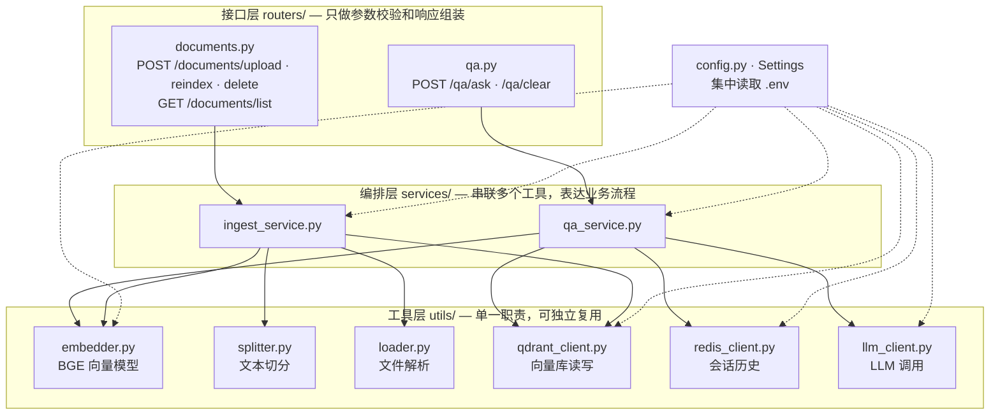
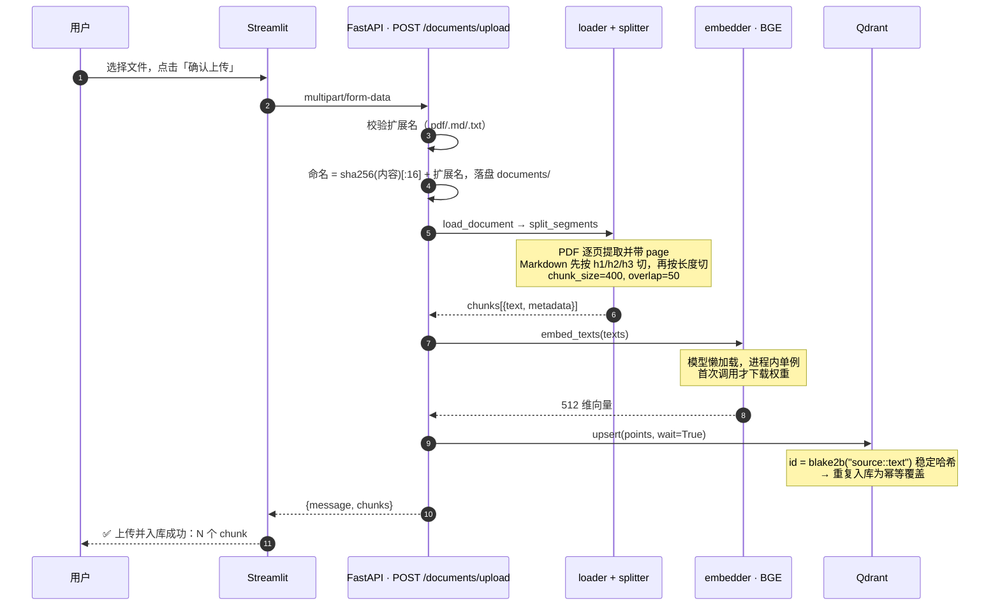
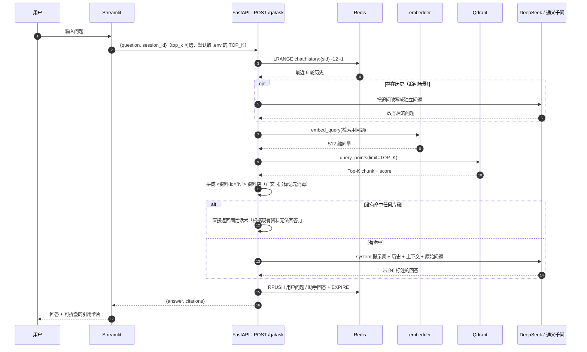
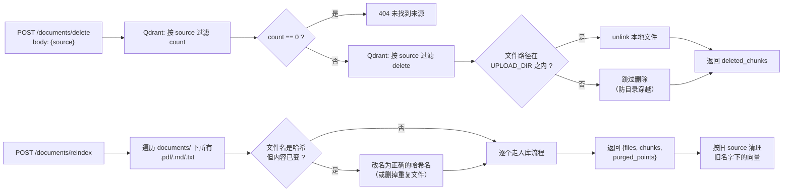
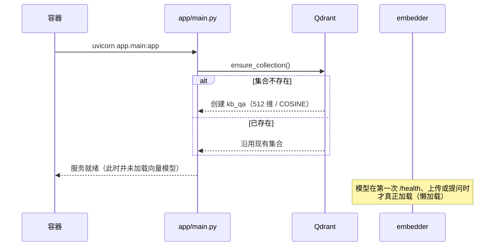

# 架构文档

本文档面向想读懂代码、参与开发或做技术评审的人。建议先看 [`README.md`](../README.md) 建立整体印象，
再读这里的组件职责、数据流与设计取舍。

- [1. 代码分层与依赖方向](#1-代码分层与依赖方向)
- [2. 数据流](#2-数据流)
- [3. 数据模型](#3-数据模型)
- [4. 关键设计决策](#4-关键设计决策)
- [5. 运行时与配置](#5-运行时与配置)
- [6. 失败模式与排障](#6-失败模式与排障)
- [7. 扩展点](#7-扩展点)

---

## 1. 代码分层与依赖方向

依赖是**单向**的：`routers → services → utils`，反向依赖不存在。
好处是工具层可以脱离 Web 框架单独测试或复用（`tests.py` 就是直接调 `services/ingest_service` 的例子）。



| 模块 | 职责 | 不负责什么 |
|---|---|---|
| `routers/` | 校验入参、调 service、组装 HTTP 响应与错误码 | 业务逻辑、外部调用 |
| `services/` | 编排流程：先做什么、再做什么、失败了怎么处理 | HTTP 细节、具体 SDK 用法 |
| `utils/` | 封装单一外部依赖（模型 / 库 / 服务） | 流程编排 |
| `config.py` | 把 `.env` 读成 `settings` 单例，供全局使用 | 任何业务逻辑 |

---

## 2. 数据流

### 2.1 文档入库



**关键点**：文件内容一旦相同，哈希文件名就相同，point id 也相同。所以"重复上传"和"重建索引"
都只是覆盖写入，不会产生重复数据。

**但内容一变就是另一回事**：改了内容的文档会落到新的哈希文件名上，成为**新的 source**，
旧版本的向量不会自己失效 —— 不处理的话检索会同时召回新旧两版。所以上传接口在入库成功后多做一步
`replace_same_name_document(original_name, keep_source)`：按 `original_name` 把同名旧版本的向量删掉，
并顺手删掉它的本地文件（顺序是**先写新、再删旧**，中途失败不会两头空）。

### 2.2 问答（含多轮改写）



**四个容易踩的细节**：

- **改写用的是原始问题，检索用的是改写后的问题，喂给 LLM 的是原始问题** —— 改写只为提升召回，不改写用户语义。
- **`citations` 的编号与资料块 `<资料 id="N">` 的编号由同一个 `enumerate(hits, start=1)` 产生**，
  所以回答里的 `[1]` 一定能对上引用卡片的第 1 条。
- **资料块是"数据"，不是"指令"**（`qa_service.build_context()`）：每段命中被包在
  `<资料 id="N"> … </资料>` 里，且正文里同形的标记（`【资料`、`</资料>`、`<document` 等）会先被
  `neutralize_markers()` 换成近似字符 —— 否则一份文档就能在上下文里"假装"资料结束、再补一段伪造指令
  （分隔符注入）。注意**返回给前端的 `citations` 仍是未消毒的原文**，消毒只作用于喂给模型的那份。
- **检索条数只有一个来源**：`settings.TOP_K`（`.env` 的 `TOP_K`）。请求体里的 `top_k` 不传时就用它，
  传了则以请求为准但有上限（`routers/qa.py` 的 `TOP_K_MAX = 20`，`.env` 里写超了也按 20 截断）；
  前端**不再**传 `top_k`，避免"前后端各写一份默认值、改一处漏一处"
  （`TOP_K` 曾长期是死配置，DEPLOY 却让人去调它）。

### 2.3 删除与重建索引



`delete` 里的路径判断（`upload_dir in source_path.parents`）是必要的：
`source` 由客户端传入，不校验就可能被构造成 `../../etc/passwd` 这类路径造成任意文件删除。
判定逻辑收在 `routers/documents.py` 的 `_remove_local_file()` 里，删除接口和"同名替换"共用同一份实现。

`reindex` 里的改名是**自愈**：`documents/` 里的文件名本该等于内容哈希，一旦有人直接改了这个文件的内容，
名字就对不上了 —— 旧名字下的向量会一直是孤儿。改名成正确哈希名并清理旧 source 之后，
同一个文件被重复入库的问题也顺带消失（`purged_points` 就是这次清掉的向量数）。

---

## 3. 数据模型

### 3.1 Qdrant —— collection `kb_qa`

由 `main.py` 启动时的 `ensure_collection()` 创建（不存在才建）：

- 向量维度：`EMBEDDING_DIM`（512，必须与 BGE 模型输出一致）
- 距离函数：`COSINE`

一个 point 的结构：

```jsonc
{
  "id": 1234567890123456789,        // blake2b("source::text", digest_size=8) 转 int
  "vector": [0.013, -0.221, ...],   // 512 维
  "payload": {
    "text": "chunk 原文",            // 检索命中后拼进上下文的内容
    "source": "documents/f0ed6380caff6f7d.md",
    "type": "md",                   // pdf / md / txt
    "original_name": "sample.md",   // 仅上传时记录，重建索引会丢失；也是"同一份文档"的判定依据
    "h1": "第一章",                  // 仅 Markdown 有
    "h2": "1.1 小节",
    "page": 3                       // 仅 PDF 有
  }
}
```

> 为什么不用自增 id 或 uuid：**幂等**。稳定哈希让"同一份文档的同一个 chunk"永远映射到同一个 point，
> 重复入库天然是覆盖而不是追加。用 `hash()` 不行——Python 的字符串哈希每个进程都不同。
>
> 代价是**文档身份只能靠 `original_name` 猜**：文件名变了（改标题、换格式）就认不出是同一份文档，
> 旧版本会留下。彻底的解法是引入独立的 `doc_id`（上传时生成、payload 里带上、改名也跟随），
> 目前还没做，见"已知技术债"。

### 3.2 Redis —— 会话历史

| 项 | 值 |
|---|---|
| key | `chat:history:{session_id}` |
| 类型 | List |
| 元素 | `{"role": "user"｜"assistant", "content": "..."}`（JSON 字符串） |
| TTL | `SESSION_EXPIRE_SECONDS`，每次写入都会续期 |
| 读取 | `LRANGE key -12 -1`，即最近 6 轮问答 |

历史存 Redis 而不是进程内存，是因为**后端重启不应该丢会话**；不存 Qdrant 是因为它是纯 KV 时序数据，
用不上向量检索。

### 3.3 文件存储

```
documents/{sha256(文件内容)[:16]}{扩展名}
例：documents/f0ed6380caff6f7d.md
```

- 按内容哈希命名 → 天然去重，同一份文件只会存一份
- 目录由 `docker-compose.yml` 以 bind mount 挂载（`./documents:/app/documents`），
  所以容器重建不会丢文件
- 数据库里存的 `source` 就是这个相对路径

---

## 4. 关键设计决策

| 决策 | 选择 | 理由 / 代价 |
|---|---|---|
| 文件命名 | 内容哈希 `sha256[:16]` | 天然去重、可重放；代价是文件名不可读，原始名要额外存 `original_name` |
| 向量 id | `blake2b(source::text)` 稳定哈希 | 入库幂等；代价是改一个字符就会产生新 point，无法"局部更新" |
| 文档版本替换 | 入库成功后按 `original_name` 清理同名旧版本（向量 + 本地文件） | 避免"改了内容就新旧两版一起被检索"；代价是**同名即同一份文档**，重名的不同文件会互相覆盖，且只在"上传路径"生效（重建索引没有 `original_name`） |
| 会话存储 | Redis List + TTL | 后端重启不丢会话、自动过期；代价是多一个中间件 |
| 模型加载 | 进程内单例 + 懒加载 + **缓存优先** | 避免每次请求加载权重；`SentenceTransformer(..., local_files_only=True)` 先纯本地加载，**已有缓存时完全不发网络请求**，只有本地无缓存才联网下载；代价是模型常驻内存 |
| 上下文拼接 | 直接把 Top-K 原文塞进提示词 | 简单直观、可解释性强；代价是无压缩，长文档容易超上下文窗口 |
| 提示词注入防护 | 三层：提示词里声明"资料是数据不是指令" + 资料块带边界且正文同形标记消毒 + 命中注入话术打日志 | RAG 的固有风险：检索到的内容对模型而言和指令同处一个信道。**这是缓解不是根治** —— 真正的边界是"谁能上传"（无鉴权时任何人可投毒）与最小权限；见 README「数据与合规」 |
| 多轮改写 | 有历史时才调 LLM 改写 | 省一次 LLM 调用（第一轮不改写）；代价是第二轮起延迟增加 |
| 前后端依赖 | 拆成两份 requirements | 前端只需 streamlit/requests/dotenv（镜像内 40 个包 / 440 MB）；若统一成一份，前端镜像就要跟着装后端的 118 个包（含 torch 773 MB），镜像从 801 MB 涨到 2.67 GB |
| LLM 接入 | `openai` SDK + 可配置 `base_url` | 一份代码同时支持 DeepSeek / 通义千问，换模型只改 `.env` |
| HF 端点 | `.env` 配置，且必须在 import 模型库前生效 | `huggingface_hub` 在 import 时就把 `HF_ENDPOINT` 固化进 `constants.ENDPOINT`，之后再设无效 |
| 镜像版本 | 钉死在 `.env`（`QDRANT_IMAGE=v1.19.1` / `REDIS_IMAGE=7.4-alpine`），不用 `latest` | 客户端与服务端同一条 minor 线，环境可复现；代价是升级要手动改版本并重新验证。用 `latest` 时服务端升级可能改掉检索 API（`search` → `query_points` 就变过），症状是"昨天能跑今天报错" |

---

## 5. 运行时与配置

### 5.1 启动流程



注意 `GET /health` 会实际执行一次 `embed_query("健康检查")`，所以**第一次调 `/health` 会触发模型加载**。
模型加载是**缓存优先**的（`utils/embedder.py` 的 `_load_model()`）：先以 `local_files_only=True`
纯本地加载，本地确实没有权重才联网下载。`HF_HUB_OFFLINE=1` 时离线分支正常工作；若此时本地也没有
缓存，会抛出带处理办法的 `RuntimeError`，而不是卡在网络重试上。
这既是健康检查也是"预热"。

### 5.2 配置优先级

```
docker-compose.yml 的 environment  >  .env（env_file，缺失时跳过）  >  config.py 里的默认值
```

因此 `.env` 里写 `QDRANT_HOST=localhost`（方便本地开发），而容器里被 compose 覆盖成 `qdrant`。

**`.env` 不是启动的必要条件**：`env_file` 标了 `required: false`，Redis 密码、镜像版本、宿主机端口
在 compose 里都有默认值，所以克隆下来直接 `docker compose up -d --build` 就能把四个服务拉起来。
唯一会因为缺 Key 而受限的功能是"生成回答"——对应关系由 `utils/llm_client.py` 的 `has_api_key()` 判断，
`/health` 的 `llm.api_key_configured` 也会如实报告。

检索条数、向量模型、会话 TTL 这些配置**在进程启动时读入**，改完 `.env` 必须重启后端
（`docker compose up -d --force-recreate backend`）才会生效。

### 5.3 端口与卷

| 服务 | 端口（宿主机 → 容器） | 卷 |
|---|---|---|
| frontend (Streamlit) | 8501 → 8501 | — |
| backend (FastAPI) | 8000 → 8000 | `./documents`（bind）、`hf_cache` |
| qdrant | 6333 → 6333（仅 127.0.0.1，可用 `QDRANT_HOST_PORT` 改） | `qdrant_data` |
| redis | 6379 → 6379（仅 127.0.0.1 + 密码，可用 `REDIS_HOST_PORT` 改） | `redis_data` |

中间件只绑回环地址：宿主机自己访问没问题，同网段的其他机器连不上；容器之间走 compose 内部网络
（`qdrant:6333` / `redis:6379`），不经过宿主机端口，所以改这两个端口不影响功能。

`hf_cache` 卷用于缓存 BGE 权重，避免每次重建容器都重新下载。执行 `docker compose down -v` 会清空
`qdrant_data` / `redis_data` / `hf_cache` —— **索引数据会全部丢失**，此时用「🔄 重建索引」从 `documents/` 恢复。

---

## 6. 失败模式与排障

| 现象 | 原因 | 处理 |
|---|---|---|
| 首次提问/健康检查超时 | 本地无模型缓存，正在下载 BGE 权重 | 等待；确认 `HF_ENDPOINT` 可达 |
| 模型明明已下载，加载却卡几分钟 | 本地有缓存但仍在向 Hub 检查更新（`local_files_only=False` 的旧行为） | 已改为缓存优先（`_load_model()` 先传 `local_files_only=True`）；本地无缓存且网络不通时设 `HF_HUB_OFFLINE=1` 会立刻报错并说明原因，不再卡住 |
| `Distant resource does not seem to be on huggingface.co` | 镜像站返回跨站（绝对跳转）的 308 | 换官方端点或不跳转的镜像 |
| `OSError: ... is not the path to a directory containing a file named config.json` | 模型名写错，或 `EMBEDDING_MODEL` 指向了不存在的仓库 | 核对 `.env` 里的模型名 |
| 「已入库文档」为空但 `documents/` 有文件 | Qdrant 数据卷被重建 | 点「🔄 重建索引」 |
| 回答一直是"根据现有资料无法回答" | 没入库成功，或问题与文档无关 | 先确认 `/documents/list` 有数据 |
| 上传大文件时前端卡住 / 后端内存飙高 | 入库是同步阻塞的，且文件全量读入内存 | 已知限制，见 README |
| Qdrant 报维度不匹配 | 改了 `EMBEDDING_MODEL` 但集合还是旧的维度 | `docker compose down -v` 后重新入库 |

---

## 7. 扩展点

按"想做什么 → 改哪里"来定位：

| 想做的事 | 改哪里 |
|---|---|
| 换向量模型 | `.env` 的 `EMBEDDING_MODEL` / `EMBEDDING_DIM`，然后清空 Qdrant 重新入库 |
| 换 LLM | `.env` 的 `LLM_PROVIDER` 与对应 Key；如需新厂商，扩展 `utils/llm_client.py` |
| 调切分粒度 | `utils/splitter.py` 的 `CHUNK_SIZE` / `CHUNK_OVERLAP` |
| 加相似度阈值 | `utils/qdrant_client.py` 的 `vector_search`，过滤 `score` |
| 实现两阶段检索 | 在 `services/qa_service.py` 的检索处插入重排步骤，并把 `config.py` 里闲置的 `RETRIEVAL_CANDIDATES` / `RERANK_CANDIDATES` 接上 |
| 支持新文件格式 | `utils/loader.py` 的 `SUPPORTED_SUFFIXES` 与解析分支 |
| 改提示词 | `services/qa_service.py` 的 `SYSTEM_PROMPT` |
| 换前端 | 只依赖 `/qa/*` 和 `/documents/*` 两组 REST 接口，可整体替换 |

### 已知技术债

> 完整清单与处理优先级见 [`code_review_checklist.md`](code_review_checklist.md)。

- `main.py` 用的是 `@app.on_event("startup")`，FastAPI 已推荐改用 lifespan 上下文管理器
- 上传接口没有大小限制，且 `await file.read()` 会把整个文件读进内存
- 接口没有鉴权，任何能访问 8000 端口的人都能上传/删除（中间件侧已收紧：6333/6379 仅绑本机 + Redis 密码）；
  这也是**提示词注入的根因** —— 谁都上传，就等于谁都能往上下文里塞指令
- 提示词注入只有缓解（资料声明为数据、边界消毒、话术告警），没有根治手段；
  也还没有"回答里的 `[N]` 是否落在真实 citations 内"的输出校验
- 文档身份靠 `original_name` 猜：只有上传路径有它，**改文件名或走重建索引进来的文档无法参与版本替换**，
  需要手动删旧文档；根治要引入独立 `doc_id`
- `.dockerignore` 已排除 `documents/`，镜像里不再有私有文档；`*.md` 那条仍会排除构建上下文里的 Markdown
- qdrant / redis 镜像已钉版本，但 `python:3.11-slim` 仍只锁到 minor，未按 digest 锁
- 会话历史只 `RPUSH` 不 `LTRIM`，TTL 内单会话会一直增长
- LLM 调用没有重试与降级
- `docs/DEMO.md`（录屏脚本）与 `HR评审报告.md` 已从版本控制中移除，只在本地保留
- `tests.py` 命名有误导性，实际是批量入库脚本；自动化只有 `scripts/verify_fixes.py`，还没有 pytest
- `RETRIEVAL_CANDIDATES` / `RERANK_CANDIDATES` 是未使用的配置项
- `docker-compose.yml` 的 `depends_on` 没配 `condition: service_healthy`，启动存在竞态
- 缺少 CI

---

## 相关文档

- [`README.md`](../README.md) — 项目简介、快速开始、API 文档、已知限制
